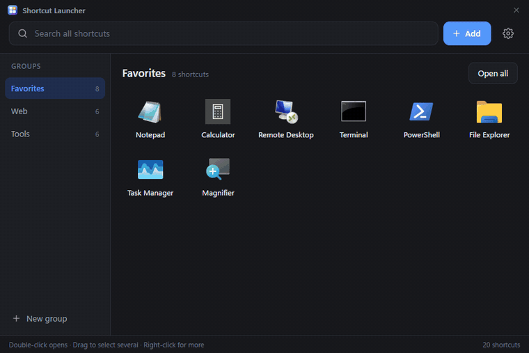
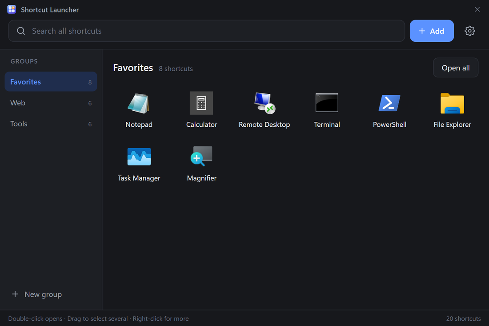
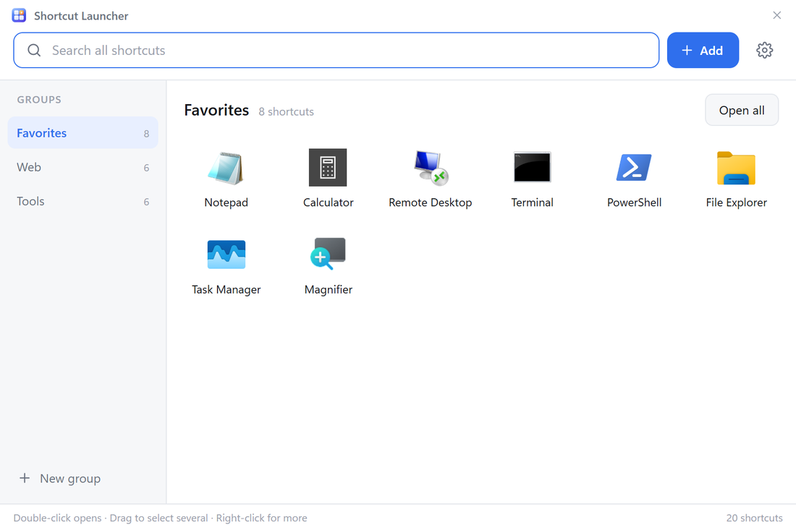
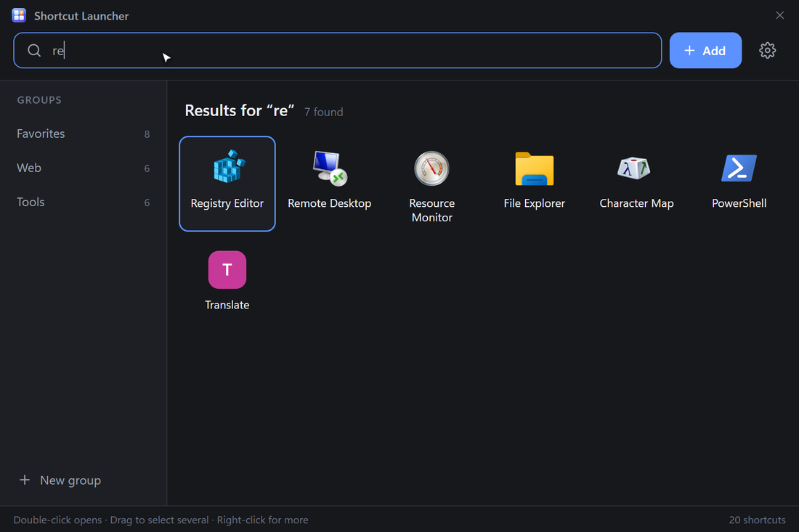
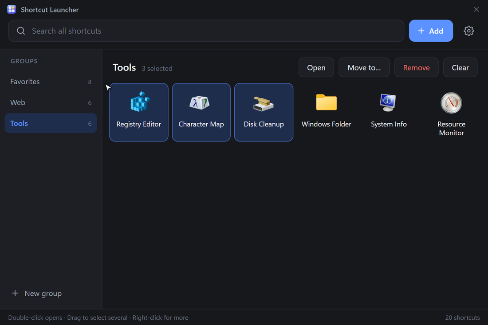
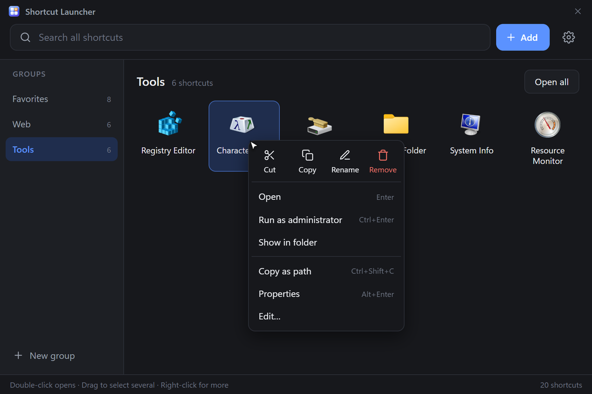
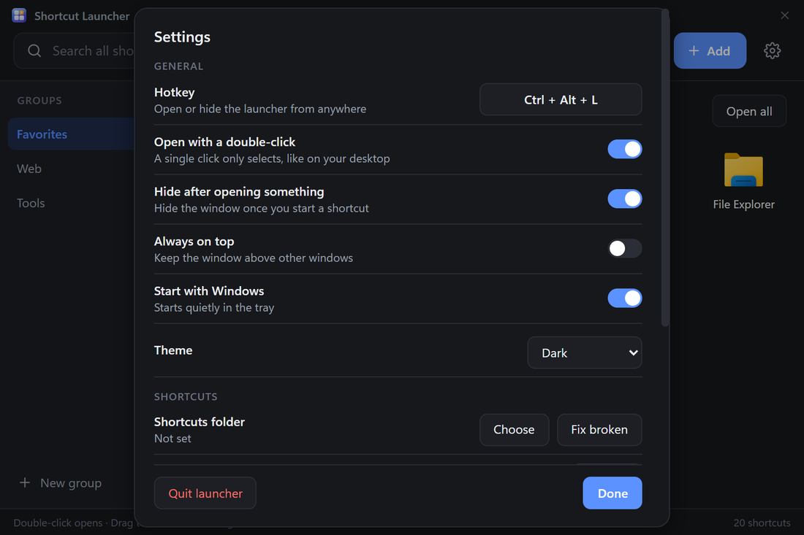

<div align="center">


# Shortcut Launcher

**One small, fast window for every app, file, folder and website you open.**<br>
Press a hotkey, click or type, and it starts.




</div>

## Why

Your desktop fills up with icons. Shortcut Launcher keeps all of them in one clean window that is always one hotkey away, with search, groups and real Explorer behaviour (right-click menu, copy and paste, drag and drop), and it never loses your data.

It is a single ~4 MB executable. No installer, no account, no telemetry, no network access.

## Features

- **Global hotkey** (default `Ctrl+Alt+L`) shows or hides the launcher from anywhere
- **Instant search** across every group, ranked by match quality and how often you use something
- **Groups** you can reorder by dragging; drop a shortcut on a group to move it
- **Add anything**: installed apps (Start menu and Store apps), files, folders, websites, or just drag them in
- **Multi-select** with a rubber band, `Ctrl`+click or `Shift`+click, then open, move, copy or remove them together
- **Explorer-style right-click menu**: Cut, Copy, Rename, Remove, Open, Run as administrator, Show in folder, Copy as path, Properties
- **Real copy, paste and drag and drop**
  - `Ctrl+C` / `Ctrl+X` / `Ctrl+V` between groups
  - Copy a shortcut and paste it in Explorer or on the desktop: you get a working shortcut file
  - Drag shortcuts out of the window onto the desktop or into any folder
  - Copy files in Explorer and paste them into the launcher, or drag them in
- **Shortcuts folder**: pick one folder and every shortcut you add also gets its own `.lnk` / `.url` file there; removing a shortcut takes the file out again (kept 30 days, with Undo). Broken shortcuts are found again by name
- **Run as administrator**, custom arguments, "Open all" for a whole group
- **Import** everything on your desktop in one click
- Open with a single click or a double-click (setting), light / dark / system theme, always on top, tray icon, optional start with Windows
- Crisp icons without the frame Windows adds to old ones
- Undo for removed shortcuts and groups

## Screenshots

<table>
  <tr>
    <td></td>
    <td></td>
  </tr>
  <tr>
    <td align="center">Dark theme</td>
    <td align="center">Light theme</td>
  </tr>
  <tr>
    <td></td>
    <td></td>
  </tr>
  <tr>
    <td align="center">Instant search</td>
    <td align="center">Rubber-band multi-select</td>
  </tr>
  <tr>
    <td></td>
    <td></td>
  </tr>
  <tr>
    <td align="center">Right-click menu</td>
    <td align="center">Settings</td>
  </tr>
</table>

## Install

1. Download `ShortcutLauncher.exe` from the [latest release](../../releases/latest).
2. Put it anywhere and start it. It lives in the tray.
3. Press `Ctrl+Alt+L`.

Settings has a button that creates a desktop shortcut for the launcher itself, and a switch to start it with Windows.

> Windows SmartScreen may warn about an unsigned app the first time. Choose "More info", then "Run anyway". The source is in this repository if you prefer to build it yourself (see [Build](#build)).

Requires Windows 10 or 11 with the WebView2 runtime (included with Windows 11 and current Windows 10).

## Using it

| Do this | To get this |
| --- | --- |
| Press the hotkey | Show or hide the launcher |
| Type | Search all shortcuts |
| Click or double-click | Select or open (setting) |
| Drag on empty space | Select several |
| Drag a shortcut onto a group | Move it there |
| Drag a shortcut out of the window | Drop a shortcut file on the desktop or in a folder |
| Right-click | The full menu |

### Keyboard

| Key | Action |
| --- | --- |
| Type | Search |
| Arrow keys | Move selection |
| `Enter` / `Ctrl+Enter` | Open / open as administrator |
| `Ctrl+A` | Select all |
| `Ctrl+C` / `Ctrl+X` / `Ctrl+V` | Copy, cut and paste shortcuts |
| `Ctrl+Shift+C` | Copy the path |
| `Alt+Enter` | Properties |
| `Delete` | Remove the selected shortcuts |
| `F2` | Rename the selected shortcut (or the current group) |
| `Ctrl+N` | Add menu |
| `Ctrl+1` ... `Ctrl+9` | Switch group |
| `Esc` | Clear search, then hide to tray |

## The shortcuts folder

Many people keep their real shortcut files in a folder instead of on the desktop. Choose that folder in **Settings > Shortcuts folder** and the launcher keeps it in step:

- Everything you add gets its own file there (`.lnk` for apps, files and folders, `.url` for websites). Shortcuts that sit on your desktop are moved into it.
- **Save all** gives every shortcut you already have a file in the folder.
- Removing a shortcut takes its file out of the folder. It is not deleted: it is kept for 30 days in `removed-shortcuts` next to your data, and **Undo** puts it back.
- If a shortcut stops working, the launcher looks for it by name in the folder and repairs it (**Fix broken**).
- Documents, sub folders and anything outside the folder are never touched.

## Your data is safe

Shortcuts are saved to disk the moment you change anything, and every write is verified.

- Writes are atomic (temp file, flush, replace), so a crash or power loss cannot leave a half-written file
- The previous version is always kept as `data.bak`
- `backups/` holds the latest state of each of the last 14 days plus a snapshot every 10 minutes
- If `data.json` is damaged or missing it is restored automatically from the newest valid copy, and the damaged file is kept
- **Settings > Backup** exports a copy to any location and restores one
- Everything is logged to `launcher.log` for troubleshooting

Data lives in `%APPDATA%\app.shortcut-launcher\` (open it from Settings). Set the `SHORTCUT_LAUNCHER_DATA` environment variable to use another folder.

## Build

Requires [Node.js](https://nodejs.org), [Rust](https://rustup.rs) and the MSVC build tools on Windows.

```bash
npm install
npm run dev        # run with hot reload
npm run build:exe  # optimized single exe in src-tauri/target/release
npm run build      # NSIS installer
```

The frontend is plain HTML, CSS and JavaScript in `src/` (no bundler, no framework). The Rust side in `src-tauri/src/` handles launching, icon extraction, the clipboard and drag and drop, storage, the tray and the global hotkey.

| Path | What is in it |
| --- | --- |
| `src/` | The interface (`index.html`, `style.css`, `app.js`) |
| `src-tauri/src/main.rs` | Commands, tray, hotkey, window handling |
| `src-tauri/src/shell.rs` | Launching, icons, shortcut files, the shortcuts folder |
| `src-tauri/src/clip.rs` | Windows clipboard and drag and drop of real files |
| `src-tauri/src/store.rs` | Durable storage, backups and recovery |

## Contributing

Issues and pull requests are welcome. Please keep the app small and fast, and keep the interface, code and docs in English.

## License

[MIT](LICENSE)
